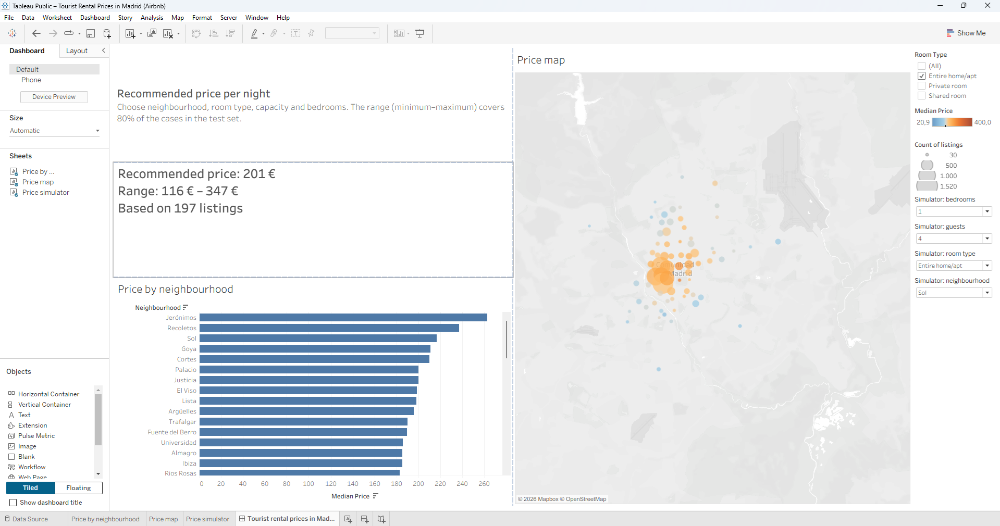

# Tourist Rental Prices in Madrid (Airbnb)

**Business question:** what price should an owner set for a new listing in Madrid, and which factors determine the price?

An end-to-end data analysis project: cleaning with Python and SQL, hedonic regression (econometrics), a predictive model (Random Forest) and an interactive dashboard with a price simulator.

**Interactive dashboard:** [View on Tableau Public](https://public.tableau.com/app/profile/daniel.alvaredo.l.pez/viz/TouristRentalPricesinMadridAirbnb/TouristrentalpricesinMadrid)



---

## Key findings

1. **Capacity is the main driver of price.** Each additional guest of capacity is associated with a price roughly **15% higher**, holding everything else constant.
2. **Room type matters a lot.** Compared with an entire home, a private room costs about **34%** less and a shared room about **73%** less (controlling for neighbourhood).
3. **The superhost effect is small.** Raw, superhosts charge 7.7% more. Once size, room type and neighbourhood are controlled for, the difference falls to roughly **5.5%**.
4. **Location matters, but explains less than expected.** Adding the neighbourhood raises the regression's adjusted R² from 0.422 to 0.492.
5. **A Random Forest predicts better than linear regression**, but with a mean absolute error of about **€62 per night** (see Limitations).
6. **Expensive centre, cheaper periphery.** Among neighbourhoods with at least 30 entire homes, the highest median prices are in Jerónimos, Recoletos, Sol, Goya and Cortes.

## Data

- **Source:** [Inside Airbnb](https://insideairbnb.com/get-the-data/), Madrid, file `listings.csv.gz` (detailed listings). Download date: 22 September 2026. Check the data terms of use on the Inside Airbnb website.
- **Initial size:** 23,109 listings and 90 columns.
- **After cleaning:** 18,573 listings.

## Methodology

### 1. Cleaning (Python, pandas)

- Price came as text with a `$` symbol; it was converted to a number.
- The 18.7% of listings without a price (4,324 rows) were removed, because price is the variable to be explained and it was not imputed.
- Extreme prices outside the **€20–€1,000 per night** range were discarded (212 rows). The original maximum was €36,883 and the median was €151.
- Missing ratings (2,613 listings) correspond in 100% of cases to listings **with no reviews**, so they are not lost data. Instead of imputing them, the variable `has_reviews` was created.
- `log_price` was created to work with the logarithm of price, which has a much more symmetric distribution and lets the coefficients be read as percentage changes.

### 2. Database and SQL

The cleaned data was stored in a **SQLite** database and explored with SQL queries (aggregations by neighbourhood, room type and superhost status). To avoid unreliable averages, the neighbourhood queries require a minimum number of listings (`HAVING COUNT(*) >= 50`).

### 3. Hedonic regression (statsmodels)

OLS regression on `log_price` with heteroskedasticity-robust standard errors (HC3).

| Variable | Model 1 | Model 2 (with neighbourhood) |
|---|---|---|
| Private room (vs. entire home) | -38.2% | -34.3% |
| Shared room (vs. entire home) | -74.1% | -73.3% |
| Each additional guest of capacity | +15.8% | +15.4% |
| Superhost | +4.9% | +5.5% |
| Has reviews | +7.0% | +7.7% |
| R² / adjusted R² | 0.422 / 0.422 | 0.496 / 0.492 |

(Percentage effect computed as `exp(coefficient) - 1`. 18,534 observations after excluding listings with no bedrooms reported or no superhost data, and the 29 "Hotel room" listings.)

### 4. Predictive models (scikit-learn)

80% training and 20% test split. The Random Forest configuration was chosen by cross-validation on the training set only, and the test set was used just for the final evaluation.

| Model | Test R² | Mean absolute error |
|---|---|---|
| Linear regression (with reviews, superhost and availability) | 0.483 | €66.6 |
| Random Forest (with reviews, superhost and availability) | 0.611 | €58.4 |
| Random Forest without availability | 0.565 | €61.1 |
| **Random Forest for a new listing (final model)** | **0.553** | **€62.2** |

### 5. Design decisions and their rationale

- **Variables excluded from the final model.** `availability_365`, `has_reviews` and `superhost` were removed from the model that recommends prices: an owner about to publish a new listing does not know its future availability, and has no reviews or superhost status. Including them would have used information that does not exist at the moment of the decision. These variables stay in the regression, where they help *explain* price. Excluding them cost little: test R² went from 0.565 to 0.553.
- **An inconsistency found and fixed.** A first version of the simulator kept `has_reviews` and gave unstable predictions depending on the value chosen (for the same combination, the price jumped by more than 50% between "with reviews" and "without reviews"). Checking the counts showed only 13–15 listings without reviews in those cells.
- **Uncertainty range.** The simulator does not return a single price but a range (minimum–recommended–maximum) built from the 10th and 90th percentiles of the test-set errors. Coverage stays between 77% and 82% across the ten deciles of predicted price.
- **Threshold of 30 entire homes per neighbourhood** in the dashboard, to avoid unreliable medians (from 126 neighbourhoods down to 71).

## Dashboard (Tableau Public)

The dashboard has three parts:

1. **Median price by neighbourhood**, filterable by room type.
2. **Bubble map by neighbourhood:** colour shows the median price and size shows the number of listings.
3. **Price simulator:** choose neighbourhood, room type, capacity and bedrooms, and it returns the minimum, recommended and maximum price, together with the number of listings it rests on (a reliability indicator). It only includes combinations with at least 5 listings in the data.

## Limitations

- **The error is large.** A mean absolute error of about €62 against a median of €151 is around 40%. Variables that weigh on the real price are missing: quality and condition of the property, photos, views, floor level, renovations.
- **Slight overestimation at high prices.** In deciles 8 and 9 of predicted price, the predicted median exceeds the real one by 5–9%.
- **Rare combinations.** In cells with few listings, predictions are less reliable and can be inconsistent (for example, a recommended price that falls as capacity rises).
- **Associations, not causation.** Having reviews or being a superhost is associated with higher prices, but that does not mean that getting a review or the badge raises the price.
- **Data quality.** Some private rooms appear with 11 or 18 bedrooms, almost certainly recording errors.
- **Approximate map.** Each bubble is placed at the average position of the neighbourhood's listings, not at its real boundaries.
- **Asking prices, not transaction prices.** The price is the one posted by the host, not necessarily what the guest pays.
- **A single snapshot in time.** The data is from one specific date and does not account for seasonality.

## How to reproduce it

1. Install [Anaconda](https://www.anaconda.com/) (it includes Python, Jupyter, pandas, statsmodels and scikit-learn).
2. Download `listings.csv.gz` for Madrid from [Inside Airbnb](https://insideairbnb.com/get-the-data/) and save it in `data/`. The file is not included in this repository because of its size.
3. Run the notebook `01_load_and_clean.ipynb` from start to finish.
4. For the dashboard, open `data/airbnb_madrid.xlsx` in Tableau (sheets `listings` and `simulator`).

## Repository structure

```
airbnb-madrid/
├── 01_load_and_clean.ipynb      # cleaning, SQL, regression and models
├── data/
│   ├── listings_clean.csv       # cleaned data
│   ├── price_simulator.csv      # simulator table
│   └── airbnb_madrid.xlsx       # dashboard input
├── img/
│   └── dashboard.png            # dashboard screenshot
└── README.md
```

## Tools

Python (pandas, NumPy, matplotlib, statsmodels, scikit-learn), SQLite, Jupyter and Tableau Public.

## Author

Daniel Alvaredo López, Economics student. [Tableau Public profile](https://public.tableau.com/app/profile/daniel.alvaredo.l.pez)
